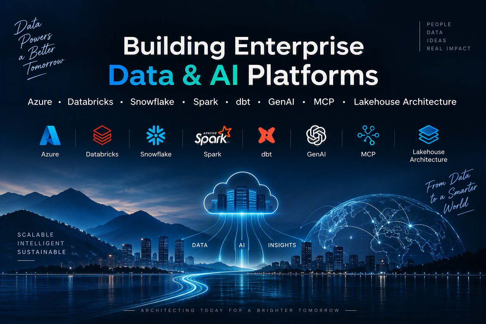

# Hi, I'm Sravan Kumar 👋

Senior Software Engineer | Data Engineer | AI & Data Platform Architect

🚀 Building scalable Data & AI platforms on Azure
☁️ Azure Databricks | Apache Spark | Snowflake | dbt
🤖 Generative AI | MCP | Agentic AI | RAG
🏗️ Lakehouse Architecture | Data Governance | Data Platforms

📍 India
💼 Open to Remote Contract & Consulting Opportunities

## Expertise

- Data Engineering
- Data Architecture
- Azure Databricks
- Apache Spark
- Snowflake
- dbt
- Delta Lake
- Python
- Java
- Spring Boot
- AI Engineering
- MCP Servers
- Agentic AI Systems
  

  
  

## Featured Projects

| Project | Stack | What it shows |
|---|---|---|
| [Azure Databricks Lakehouse Platform](https://github.com/sravan4rmhyd/azure-databricks-lakehouse-platform) | PySpark, Delta Lake, Databricks Asset Bundles | Medallion architecture, quarantine-based data quality gates, idempotent MERGE upserts, CI |
| [MCP RAG Knowledge Assistant](https://github.com/sravan4rmhyd/mcp-rag-knowledge-assistant) | Python, MCP, vector retrieval, Claude | RAG with citations, an MCP server with typed tools, offline retrieval evaluation (recall@k, MRR) |
| [Data Platform Accelerator](https://github.com/sravan4rmhyd/data-platform-accelerator) | Python, DuckDB, SQL, YAML | Config-driven ingestion/transform, dbt-style models, severity-based data-quality checks, run reports |

## Connect

- LinkedIn: https://www.linkedin.com/in/sravan4rmhyd/
- Email: sravan4rmhyd@gmail.com
